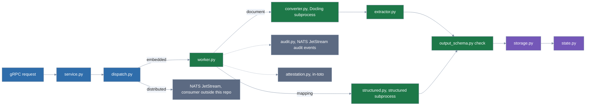

# Architecture

For contributors who need to find their way around the code. Back to the [README](../../README.md).



The service has three primary components:

1. **gRPC Service** (`service.py`, `server.py`): Handles `ConvertDocument`, `GetDocument`, and `ListDocuments` RPCs.
2. **Dispatch Layer** (`dispatch.py`): Routes jobs to either embedded workers or NATS JetStream.
3. **Worker** (`worker.py`): Fetches, validates, converts, extracts, stores, and attests documents.

```
gRPC Request → Dispatch → Worker → [Converter → Extractor | Structured] → Output schema check → Storage → State → Response
```

**Security Modules:**
- `security.py`: SSRF prevention, URL validation, content type detection, resource limit enforcement. URL fetches connect directly and ignore `HTTP_PROXY`/`HTTPS_PROXY`/`ALL_PROXY`: the address actually connected to is checked against the blocked ranges, and through a proxy that check would only see the proxy.
- `converter.py`: Async subprocess-based Docling execution with rlimits and timeout; the subprocess's process group is killed on timeout or cancellation
- `extractor.py`: Structured element extraction from Docling output
- `heading_levels.py`: Heading levels for PDF headings Docling leaves flat, inferred from section numbering
- `html_backend.py`: Docling HTML backend that drops navigation and, on pages with a main landmark, page-level `<header>`/`<footer>` before conversion, and applies the HTML profile a page matches (design: [docs/html-profiles.md](../html-profiles.md))
- `output_schema.py`: Validates every output against the versioned output schema before it is stored (design: [docs/output-schema.md](../output-schema.md))
- `quality.py`: Measures structure signals (`metadata.structure`) from the extracted elements
- `html_profile.py`, `html_profiles/`: Load, validate and register HTML profiles at startup; the packaged profiles are the `*.yaml` files in `html_profiles/` (maintainer notes: [docs/html-profiles.md](../html-profiles.md))
- `mapping.py`: Loads, validates and registers structured-source mappings at startup
- `structured.py`: Reads JSON, CSV and XLSX through a mapping into elements, in the structured worker subprocess (design: [docs/structured-sources.md](../structured-sources.md))

**Supporting Modules:**
- `state.py`: Management of the state of document records (async interface; memory, or Redis via `redis.asyncio`)
- `storage.py`: Blob storage (filesystem or S3)
- `attestation.py`: Generation of metadata for in-toto links
- `audit.py`: Publisher of audit events to NATS JetStream
- `config.py`: Pydantic settings with environment variable overrides
