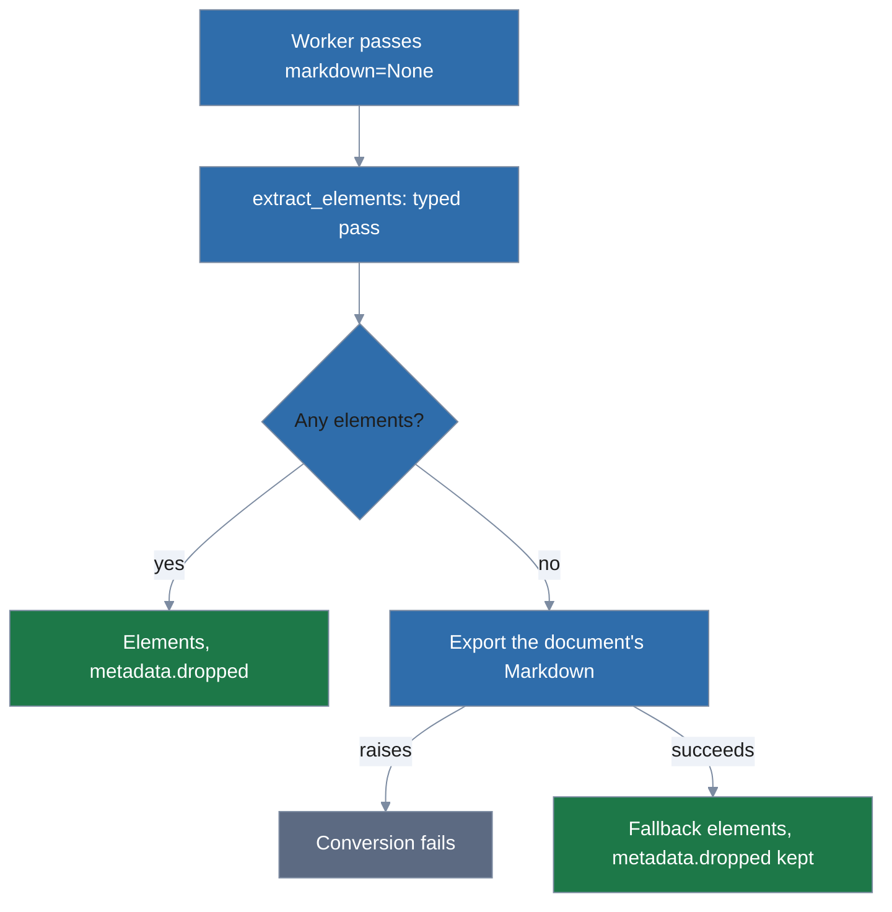

# Output schema: design notes

For maintainers (back to the [README](../README.md)). The consumer-facing description of the format and its guarantees is
[Output format](usage/output-format.md); this page explains how the contract is enforced and how to change it.

## Where each part of the output comes from

| Step       | Module                                                                                                             | Process                     | Adds                                                        |
|------------|--------------------------------------------------------------------------------------------------------------------|-----------------------------|-------------------------------------------------------------|
| Extraction | `extractor.py` (documents) or `structured.py` (structured sources, [structured-sources.md](structured-sources.md)) | resource-limited worker subprocess | `elements`, `metadata` except `processing_time_ms`          |
| Collection | `converter.py` (`convert_document`, `convert_structured`)                                                          | service                     | `metadata.processing_time_ms`, `schema_version` (first key) |
| Validation | `worker.py` (`run_conversion`) via `output_schema.validate_output`                                                 | service                     | nothing; raises `OutputSchemaError`                         |
| Storage    | `worker.py`                                                                                                        | service                     | nothing                                                     |

## Decisions

**Validate in the service, right before storage.** The subprocess parses untrusted documents, so its
output is untrusted input to the service. Validating the final dict (after the service adds its own
fields) means the object that is checked is exactly the object that is stored. No validation happens in
the subprocess: it would duplicate the check, and a compromised worker could skip it.

**One schema file, compiled once.** `schemas/structured-output-v1.json` is package data (hatch includes
non-Python files under `src/crosscodex_ingestion/`). `output_schema.py` loads it with
`importlib.resources`, runs `check_schema` and builds one `Draft202012Validator` at import, so a broken
schema fails service start-up, not a conversion.

**One file per major; it validates every released minor.** The schema's `schema_version` is an `enum` of
every released 1.x, not a `const`. Outputs already stored under 1.0 must keep validating after 1.1 ships,
and they do, because a minor only adds optional fields. The version the service emits is the separate
constant `SCHEMA_VERSION` in `output_schema.py`. Import fails if the enum doesn't list it, so the two can't
drift apart.

**Rules JSON Schema can't express are checked in code.** JSON Schema can't relate one array item to
another, or compare a value with an array's length. So unique `element_id`, "a non-null `parent_id` names
an earlier element", "non-null source `id` values are unique" (1.1) and "`metadata.element_count` equals
the number of elements" live in `_reference_violations`. It runs only when the schema passes, so it can rely
on every field being present and typed. Further cross-element rules belong beside it.

**The schema is closed; tolerance is the reader's job.** Every object has `additionalProperties: false`.
The schema states exactly what one version emits, so a field added in code without a schema change fails
the service's own validation and tests instead of reaching consumers unannounced. Forward compatibility
comes from the version policy instead: minors only add optional fields, and readers must ignore fields
they don't know ([Versions](usage/output-format.md#versions)). The cost: a consumer that validates with the schema needs a copy at
least as new as the output, because a 1.0-era copy rejects fields that 1.1 adds.

**A non-conforming output is `ERROR_CODE_INTERNAL`, with a specific message.** (`ErrorCode` and
`Error`, whose `details` are mentioned below, are defined in
[`proto/crosscodex/v1/common.proto`](../proto/crosscodex/v1/common.proto).) It is a bug in the
service, not in the request, so it is not `INVALID_ARGUMENT`. Unlike other internal errors its message
is returned in full. It is built from locations, schema keywords and schema values. Element content is
tenant data, and the message reaches the client, the logs and the audit stream, so the only values
taken from the output are these:
- An `element_id` or `parent_id`, quoted only when it has the generated form `e-` plus 3 to 30 digits.
  The schema enforces that form, so after the schema passes every id is safe to quote.
- An unexpected property's name, quoted only when it matches `^[a-z_]{1,64}$`. Other unexpected
  properties are only counted.

A source `id` (1.1) is tenant data and is never quoted: a duplicate is reported as "duplicates the id of
elements[N]".

The schema's id pattern ends in `(?![\s\S])` rather than `$`, because Python's `$` also matches before
a trailing newline. The first violation is also returned as `Error.details` (`schema_version`,
`location`, `element_index`, `element_id`).

**Nothing is dropped silently.** The extractor lists what it doesn't emit in `metadata.dropped`:
blank headings, tables whose Markdown export raised or came out empty, and paragraphs the plain-text
fallback skips for having fewer than 5 words. Since 1.5 it also lists PDF table header rows removed on a
rejoin (`row`) and unlabelled running headers and footers (`furniture`); see "1.5: table cells and layout
repair". Text before the first heading or section is emitted as
top-level paragraphs (`parent_id: null`), not dropped. `run_conversion` logs each
entry at WARNING with the document id; the subprocess can't log usefully, because its stderr is read
only when it fails. A drop's `reason` names only the exception type, since exception messages may
quote document text.

**Blank headings are skipped without touching the heading stack.** That attaches the content under one to
the nearest non-blank heading above, and it keeps a blank heading from closing the sections above it.

**Markdown is exported only for the fallback, and drops survive it.** `DoclingDocument.export_to_markdown`
renders tables with the same `MarkdownDocSerializer` as `TableItem.export_to_markdown`. When that
serializer raises on a table, the document export raises too; this was reproduced on a real
`DoclingDocument` (`tests/integration/test_table_drop_e2e.py`). So the worker passes `markdown=None`, and
`extract_elements` exports the document's Markdown only when the typed pass yields no elements. If that
export raises, the conversion fails; it is never silent. For the same reason the fallback's Markdown
can't contain a table the typed pass dropped, so `metadata.dropped` is kept when the fallback runs.

## Changing the schema

1. Decide minor or major by the [Versions](usage/output-format.md#versions) rules. Adding an optional field is minor; anything that
   could break an existing reader is major.
2. For a minor: edit `schemas/structured-output-v1.json`, add the new fields as optional (never to
   `required`), append the new version to the `schema_version` `enum` (never remove one), and bump
   `SCHEMA_VERSION` in `output_schema.py`. For a major: create a new file and `$id` for the new major
   with a fresh `enum`. Keep the old file, so outputs already stored can still be validated, and point
   `output_schema.py` at the new one.
3. Make the producer emit the change, and update `tests/unit/output_samples.py` so it still conforms.
4. Add positive and negative cases to `tests/unit/test_output_schema.py`, and run
   `task test:integration` (`tests/integration/test_output_schema_e2e.py` validates real conversions of
   every fixture document).
5. Update [Output format](usage/output-format.md): field table, guarantees, and the example.

## 1.1: what structured sources added

`id`, `title`, `properties` on elements and `metadata.source` are optional, so 1.0 outputs still validate and
1.0 readers still work. The Docling path emits none of them: it has no source IDs, and emitting `id: null`
on every element would only add bytes. `title` is forbidden on headings (`"title": false` in the schema's
`then` branch), because a heading's title is its `content`. Property names follow the same identifier rule
as mapping property names (`^[a-z][a-z0-9_]{0,63}$`, see
[Writing a mapping](usage/structured-sources.md#writing-a-mapping)); property values are non-blank strings.

## 1.2: structure signals and HTML profiles

`metadata.structure` and `metadata.html_profile` are optional, so 1.0 and 1.1 outputs still validate and
1.1 readers still work: they never read these fields. A strict copy of the 1.1 schema would reject them,
which is why consumers must validate against a schema at least as new as the output.

- `metadata.structure` holds five non-negative counts (`heading_count`, `table_count`,
  `max_heading_depth`, `unparented_count`, `fragment_count`) and `warnings`, all required together. It is
  measured from the emitted elements by `quality.measure_structure`. `warnings` is an array of codes
  matching `^[a-z][a-z0-9_]*$`. It is deliberately not an enum, so adding a warning code is not a schema
  change.
- `metadata.html_profile` is `{id, sha256}` and is present only when an HTML profile was applied. It
  mirrors `metadata.source.mapping`: the SHA-256 identifies the exact profile file used.

## 1.3: element roles

`role`, `text`, `metadata.source.catalog_version`, and `title` on headings are optional, so 1.0 to 1.2
outputs still validate and older readers still work. The Docling path emits none of them.

Roles are declared by the mapping because the shape of a source does not say what a node is:

| Mapping | Inner node | Has text | Meaning |
|---|---|---|---|
| `owasp-asvs-5.0.0-json` | `V5`, `V5.4` | no | group |
| `nist-sp800-53r5-catalog-xlsx` | `AC-2` (children `AC-2(1)`) | yes | control with enhancements |
| `mitre-attack-enterprise-17.1-techniques-xlsx` | `T1055` (sub-techniques) | yes | control with children |
| `nist-csf-2.0-core-xlsx` | `GV`, `GV.OC` | yes | group |

A structural guess is wrong for some publisher (CSF groups have text), so the mapping's `group_levels`
names the group levels and, when absent, there are no groups. The producer sets `role` in
`structured.build_tree` once depth is known, and fails the conversion for a childless group.

- `role` and `text` are allowed only with a string `id`; `title` is forbidden only on a heading without
  one (1.1 forbade it on every heading). The schema does not require them, so 1.1 and 1.2 outputs with IDs validate. The producer
  always emits all three on an element with a string `id`, and its tests check it.
- Nullable: `title`, `text` and `metadata.source.catalog_version` are a non-blank string or `null`. `role`
  is never null. `catalog_version` is `null` when the mapping has no `version`.
- A node with children is still a heading followed by an id-less text paragraph, so 1.0 to 1.2 readers see
  the same document. A reader of `role` skips id-less elements and takes `title` and `text` from the
  element with the `id`; the paragraph's text is the same text, repeated.
- `role` is an enum (`group`, `control`) so a later minor can add values; readers should tolerate a value
  they don't know.

## 1.4: document structure

`metadata.structure_method` is required from 1.4 and the `role` enum gains `section`. 1.0 to 1.3 outputs
still validate (the requirement applies only when `schema_version` is `1.4`, and an older version may not
carry the field), and older readers still work: they ignore what they don't know.

From 1.4 every stored conversion has roles. A document is no longer returned as raw layout: the fallback
structurer (`fallback.py`) turns the layout into controls, and the output carries them in the shape 1.3
gave structured sources.

- `metadata.structure_method` is the closed enum `mapping | heading | table | pattern`. `mapping` is valid
  exactly when `metadata.source.mapping` is present, and the schema enforces both directions. The other
  three name the structurer tier that won (heading, then table, then pattern).
- A document's layout elements (headings, paragraphs, tables) are replaced by the controls the structurer
  found. They are the same element kinds as a structured source's: a node with children is a heading
  followed by an id-less paragraph with its text.
- `role` `section` is a lead-in that introduces its children and is not itself a requirement. Only
  clause decomposition produces it. The rules, checked in `output_schema.py` because JSON Schema cannot
  express them: a section has at least one child element with an `id`, and it never sits under a control. It
  sits at the top level, under a group or under a section.
- `page` is set on a structure element from the layout page it came from, and is `null` when the layout
  had none (HTML, DOCX, text). A clause takes its item's page.
- `metadata.structure` is measured on the layout, before the structure replaces it, so its counts describe
  the document Docling produced, not the controls. Its warnings (such as `no_headings`) therefore still
  tell an auditor how much structure the source offered.
- A document with no structure fails the conversion; nothing is stored. The two failures, both
  `ERROR_CODE_INVALID_ARGUMENT`, built from the format, the registry mapping IDs and (for repeated IDs) the
  winning method name from the closed enum, never document text:
  - `No controls found in this <format> document: it has no headings, tables or numbered lines the fallback structurer recognises. Convert it with a document mapping for <format>; registered: <ids>.`
  - `The fallback structurer found controls in this <format> document (method <tier>), but their identifiers repeat, so they do not form a catalog. Convert it with a document mapping for <format>; registered: <ids>.`

  `<ids>` is `none yet` when no mapping is registered for the format.

  The message's advice to use a document mapping is forward-looking: document mappings are planned (issue #38,
  phase 3) and none exist yet.

## 1.5: table cells and layout repair

`metadata.structure.table_rejoin_count` is required from 1.5, and the `metadata.dropped[].type` enum gains
`row`, `furniture` and `paragraph`. 1.0 to 1.4 outputs still validate: the schema's version gates
reject the new field and the three new `type` values below 1.5, so the requirement and the values apply
only when `schema_version` is `1.5`. A copy of the schema older than 1.5 rejects a 1.5 output, so
validate with a copy at least as new as the output.

`paragraph` was already emitted by the plain-text fallback ("fewer than 5 words") but was
missing from the enum; 1.5 adds it. `row` and `furniture` are new behaviour, and apply to PDFs only (the
only format with pages).

Three changes happen in the extractor, before `quality.measure_structure` measures the layout and before the
fallback structurer reads it:

- **Cell model.** Each layout `table` element carries `cells` (the grid as strings; a spanned cell's text
  repeats at every position it covers), `header_rows` (how many leading rows are column headers) and
  `row_pages` (the page of each grid row). They never reach the output: output elements are built from
  the structure tree by `structured.emit_elements`, which never copies layout fields, and the closed element
  schema (`additionalProperties: false`) would reject one if it leaked. Only `row_pages` is read today, by
  `measure_structure` (for `table_rejoin_count`) and by the table tier, so a control's `page` is its row's
  page, not the page the table started on. `cells` and `header_rows` are for phase 3's document mappings
  (issue #38); nothing reads them yet.
- **Rejoin.** A PDF table continued on the next page is emitted as one table element (see "Rejoin rule").
  Each repeated header row removed from a later part is a `dropped` entry of type `row`:
  `repeated header row of a table continued from page {a}; removed when the parts were rejoined`, where
  `page` is the part's page and `{a}` is the previous part's page.
- **Furniture.** A text repeated in the page margin is removed (see "Furniture rule"), and each removed
  item is a `dropped` entry of type `furniture`:
  `text repeated in the page margin on {n} pages; removed as an unlabelled running header or footer`.
  `{n}` is the number of distinct pages the text occurs on.

Both reasons contain only integers, never document text.

`metadata.structure.table_rejoin_count` is the number of page breaks across which parts were rejoined. For
each table element it is the number of distinct pages in its `row_pages`, minus one. When it is above 0 the
`warnings` array gains `table_rejoined`, once, after `no_headings`. Like the other counts it is measured on
the layout the structurer read.

### Rejoin rule

Only when the format is PDF. Table B continues table A (the last part of the chain so far) when all of
these hold:

- A and B each have exactly one page, and B is the next table after A in document order and on A's next page.
- Every item between them is removed furniture, or a text, paragraph or list item whose text is blank. A
  heading, a picture, a non-blank paragraph or any other table between them ends the chain.
- A part's own descendants (its caption and footnotes, which Docling makes its children) and the items
  its rich cells reference belong to the part: they never block a join.
- B has the same column count as the first part.
- B's leading rows equal the first part's header rows, or B has no header rows. The comparison is exact:
  cell by cell, after collapsing whitespace the way Go's `strings.Fields` does, case-sensitive and with no
  digit folding. B keeps at least one row once the matching header rows are removed, so a part that is only a
  repeated header never joins.
- Neither part is one the extractor would drop: a table whose Markdown export fails or is blank, or that
  has no rows, never joins and ends the chain.

Some real splits therefore stay split: Docling can read a repeated header differently on a later page (an
empty or truncated cell, a different width), and the rule fails closed rather than guess. An unjoined table's
`content` is byte-identical to the 1.4 output.

### Furniture rule

Only when the format is PDF. A text or paragraph item in the body is removed when its text, with whitespace
collapsed as above, is at most 100 characters, occurs on at least 3 distinct pages, and every one of its
occurrences lies wholly in the top or bottom 10% of its page. An occurrence with no position or no page size
counts as outside the margin, so an unknown position never removes text. Items Docling already labels as page
headers and footers are skipped by the extractor as before and are not listed. The three numbers are frozen
in `layout_repair.py` (`FURNITURE_MIN_PAGES`, `FURNITURE_MARGIN`, `FURNITURE_MAX_CHARS`), not configuration,
so the service version reproduces a result.
